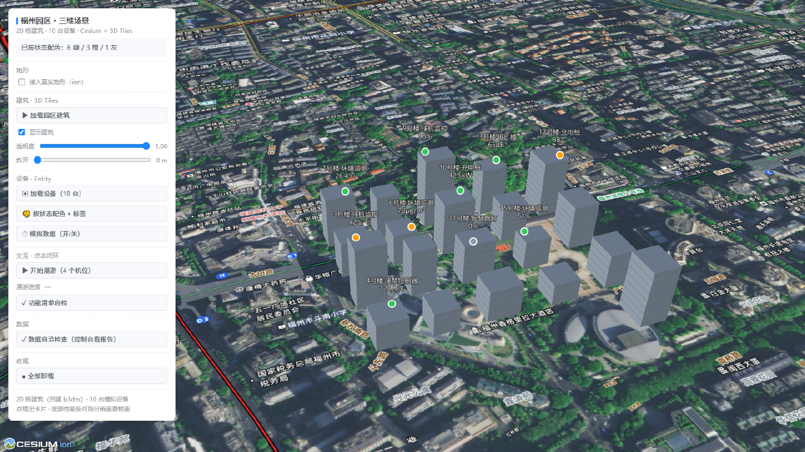
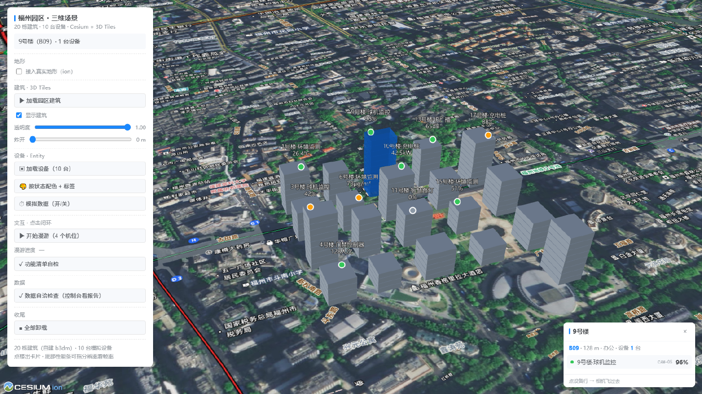
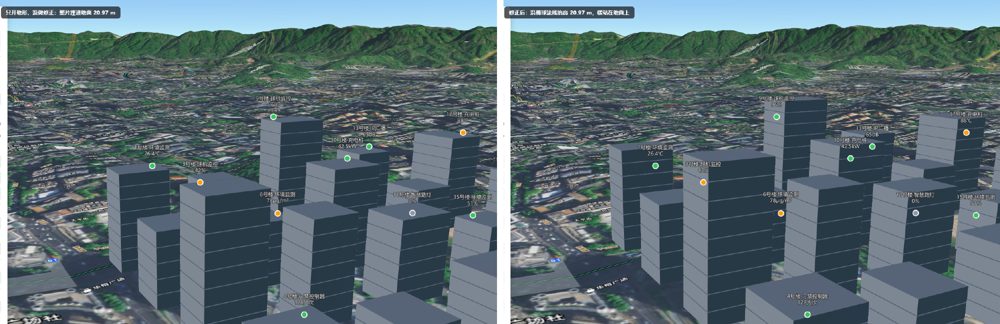
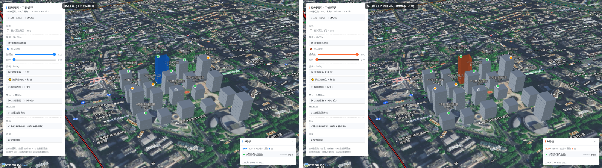
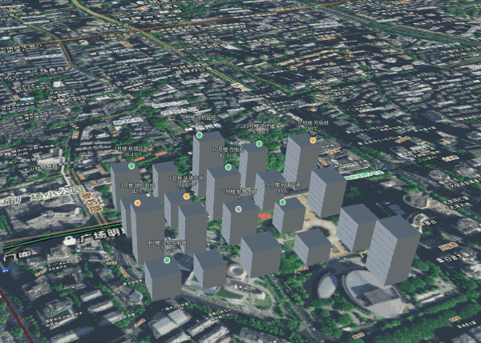

# 福州五一广场 · 三维园区

用 Cesium + 3D Tiles 做的三维园区演示：20 栋建筑、10 台设备、真实地形贴合、单栋拾取、实时性能面板。



🔗 **在线演示**：https://carol5563.github.io/fuzhou-3d-city/

## 观赏路线

- 点任意一栋楼 → 右侧弹出该楼设备卡片，楼体高亮
- 打开「加载地形」→ 楼群整体抬高贴地
- 底部性能条拖分辨率 → 看 fps 从 8 变到 33

## 效果

| | |
|---|---|
|  |  |
| 点任意一栋楼：楼体高亮 + 该楼设备卡片 | 同一机位、同一帧：左「只开地形没修正」楼被地面吃掉 20.97 m，右「贴地修正后」 |
|  |  |
| 换主题：改一个 design token，DOM 与三维场景一起变色 | 点楼 → 卡片弹出 → 楼体高亮的完整过程 |

## 功能

- 加载 3D Tiles 园区（20 栋建筑，按 12 m 切分楼层块）
- 单栋拾取：点击楼体弹出设备清单，同时高亮
- 设备点位：10 台设备钉在楼顶，按正常 / 告警 / 离线三色渲染
- 地形适配：切换真实地形后自动整片贴地
- 相机漫游：多段航线自动巡检，点击任意楼可打断
- 性能面板：实时 fps / draw call / 顶点数，一键诊断瓶颈

## 技术要点

- 自建 b3dm：20栋楼按 12 m 切127个楼层块 / 3048 顶点 / 88.4 KB,为炸开效果预留
- 地形埋楼：地形对齐：楼底在椭球高 0，开地形后整片埋 18.5~31.9 m; 用`modelMatrix` + 椭球法线 × 20.97 m 修正
- Picking: 单栋拾取：`picked.primitive` 只能拿到整个tileset, 靠 `featureId` + batch table 属性下钻到单栋
- 性能：自建 draw call  计数包（包`gl.drawElements/drawArrays`）, 定位到像素填充瓶颈；`resolutionScale` 1.0→8 fps、0.35→33 fps
- 主题：design token: 色板单一来源，DOM 走 CSS 变量、场景走 `Cesium.Color`, 改一个 token 全站变色

## 怎么跑

```bash
npm install
cp src/config.example.js src/config.js   # 填天地图 key 与 Cesium ion token
npm run dev                              # 打开 http://localhost:5174/fuzhou-3d-city/
```

## 数据说明

- 建筑：按真实楼栋位置与尺寸生成 b3dm（公开数据整理，非测绘成果）
- 地形：Cesium ion 全球地形（asset 1）
- 设备：模拟数据，仅用于演示交互
